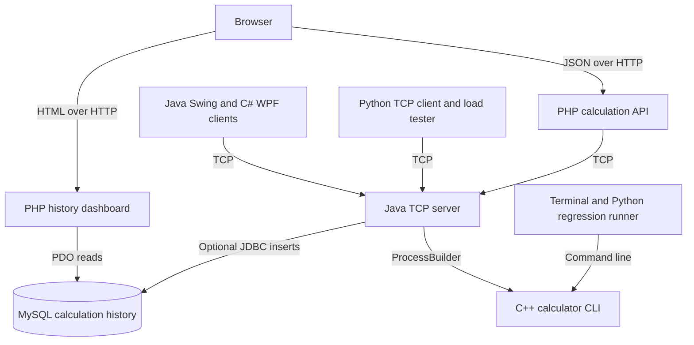

# MultiCalc architecture

The C++ calculator performs all arithmetic. Run its executable directly from a terminal or through the Python regression runner. The Python TCP client, desktop clients, and browser send calculations through the Java TCP server.

The arrows point from the caller to the component that handles a request. The PHP API converts a browser JSON request into a TCP calculation and converts the reply back into JSON. The desktop clients, Python command-line client, and Python load tester speak TCP directly. The server assigns each connection to a worker and checks each valid calculation against the shared rate limit. For an admitted request, the worker passes the expression to `calc` as a single argument and turns the process result into an `OK` or `ERR` reply. [TCP protocol](protocol.md)

With persistence enabled, a background writer queues completed outcomes and inserts them into MySQL independently of the TCP reply. The PHP dashboard uses a separate read-only account to query shared history and renders it as HTML. The browser calculator keeps recent successful calculations in local storage. [MySQL setup](../README.md#set-up-mysql-history)

The server accepts plaintext TCP on loopback by default. PHP is the TCP peer for browser calculations, so the server records PHP's address for those calculations. Dashboard access depends on the web server's configuration, and the page exposes shared history. [Threat model](threat-model.md)
